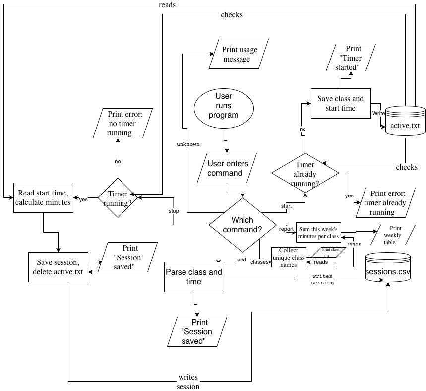

# Study Hours Tracker

A Java command-line tool that logs study time per class and shows where my study hours actually go each week.

## Project Goal

I spend a lot of time studying, but I have no idea how that time is split between my classes. This tool records every study session so I can see real numbers instead of guessing.

## MVP Scope

- **Live timer:** `start CS180` begins a session, `stop` ends it and saves it
- **Manual add:** `add MA1610 2h` (or `90m`) logs a session after the fact
- **Weekly report:** `report` shows hours per class for the current week, plus a total
- **List of classes:** `classes` shows every class that has logged time

## Future Plans (V2.0+)

- Weekly goals per class (e.g., `CS180: 4.5h / 6h`)
- Reminders when I haven't studied
- Edit or delete a wrong entry
- Daily totals
- Study streaks
- Bar charts in the terminal

## Tech Stack

- **Language:** Java (command line)
- **Libraries:** Java standard library only: `java.time`, `java.nio.file`, `String.format`
- **Data storage:** `data/sessions.csv` (one row per session: `class,start,end,minutes`) and `data/active.txt` for a running timer
- **Data sources:** none, all data is entered by the user
- **Tools:** Git/GitHub, draw.io

## Project Structure

```
src/     Java source code
data/    CSV data files
docs/    Eisenhower matrix and system diagram
```

## Planning Documents

- [Eisenhower Matrix](docs/eisenhower-matrix.md)
- [System Diagram](docs/system-diagram.png)



## Usage

*Coming soon, once the MVP is built.*
